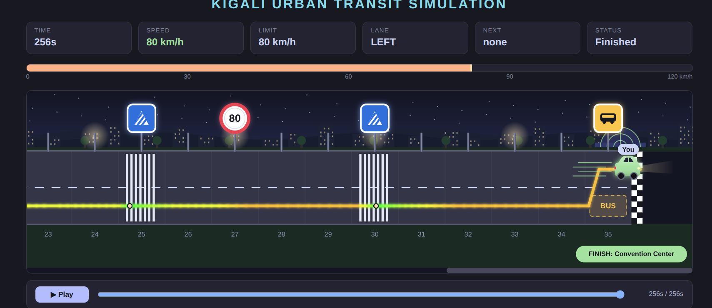

# Kigali Roads -- Full Self-Driving (FSD) Simulation

## Overview

Kigali Roads FSD is a Python-based driving simulation inspired by
everyday road conditions in Kigali, Rwanda.

The project simulates a Tesla Full Self-Driving (FSD) car travelling
from **African Leadership University (ALU Rwanda)** to the **Kigali
Convention Centre**.

During the journey, the car encounters different road signs and
conditions, including speed limits, zebra crossings, buses, and ordinary
roads. The application uses Python logic to determine how the car
responds to each situation.

A pre-built web interface displays the car's journey through Kigali at
night, while Python handles the driving logic and decision-making.


## Road Simulation Rules

The journey is represented by a Python list called `road`, located in
`road_simulation.py`.

Each list item represents a road segment.

  -----------------------------------------------------------------------
  Road Sign                           Description
  ----------------------------------- -----------------------------------
  `"60"` or `"80"`                    Sets a new speed limit.

  `"zebra"`                           Stops the car for 5 seconds before
                                      continuing.

  `"bus"`                             Moves the car to the left lane
                                      because a bus occupies the right
                                      lane.

  `"road"`                            Represents a normal road with no
                                      special action.
  -----------------------------------------------------------------------

### Example Road

``` python
road = ["60", "road", "zebra", "road", "80", "road", "bus", "road"]
```

**Important rules:** - Speed limits are stored as strings, not
integers. - Valid signs include `"bus"`, `"zebra"`, or speed limits
between 20 and 100. - Road signs can be inserted or replaced while the
program is running. - The road starts at index `0` (ALU Rwanda) and ends
at the Kigali Convention Centre.

## Application Features

The project involves implementing ten functions in `road_simulation.py`,
organized into three main categories.

### 1. Sign Detection and Validation

  -----------------------------------------------------------------------
  Function                            Responsibility
  ----------------------------------- -----------------------------------
  `is_valid_sign()`                   Checks whether a road sign is
                                      valid.

  `get_sign_type()`                   Identifies a sign as a bus, zebra,
                                      speed limit, or normal road.
  -----------------------------------------------------------------------

### 2. Driving Logic

  -----------------------------------------------------------------------
  Function                            Responsibility
  ----------------------------------- -----------------------------------
  `get_speed_limit()`                 Determines the current speed limit
                                      based on road signs.

  `get_target_speed()`                Determines the target speed,
                                      including stopping at zebra
                                      crossings.

  `adjust_speed()`                    Adjusts the car's speed towards the
                                      target speed without overshooting.

  `count_signs()`                     Counts speed signs, zebra
                                      crossings, and buses using loops.
  -----------------------------------------------------------------------

### 3. Input Validation and Road Management

  -----------------------------------------------------------------------
  Function                            Responsibility
  ----------------------------------- -----------------------------------
  `ask_for_number()`                  Validates numerical input using
                                      `try/except`.

  `insert_sign()`                     Inserts a new road sign at a
                                      specified position.

  `replace_sign()`                    Replaces an existing road sign at a
                                      specified index.

  `get_journey_summary()`             Calculates road length, counts
                                      signs, and returns journey start
                                      and end information.
  -----------------------------------------------------------------------

## Log Analyser -- Bash Script

The project also includes an optional Bash scripting task.

The application automatically records driving events in a file called
`transit_session.log`.

The `analyze_log.sh` script reads this log and generates a summary of
the driving sessions.

### Log Analyser Features

-   Accepts a log filename as a command-line argument.
-   Uses `transit_session.log` by default when no filename is provided.
-   Checks whether the specified file exists.
-   Counts the number of driving sessions.
-   Counts zebra crossing stops.
-   Counts lane changes.
-   Displays the driver name and top speed of the latest trip.

## Project Structure

``` text
lab1_githubUsername/
│
├── road_simulation.py
├── engine.py
├── transit_program.py
├── index.html
├── analyze_log.sh
├── transit_session.log
└── README.md
```

### File Descriptions

  -----------------------------------------------------------------------
  File                                Description
  ----------------------------------- -----------------------------------
  `road_simulation.py`                Contains the main Python
                                      application and functions to
                                      implement.

  `engine.py`                         Handles the simulation engine.

  `transit_program.py`                Supports the driving simulation
                                      program.

  `index.html`                        Provides the visual web interface.

  `analyze_log.sh`                    Bash script for analysing driving
                                      logs.

  `transit_session.log`               Stores events recorded during
                                      simulation sessions.

  `README.md`                         Provides project documentation.
  -----------------------------------------------------------------------

## How to Run the Application

### Prerequisites

-   Python 3 installed.
-   Bash terminal.
-   A code editor such as VS Code.

### Step 1: Clone the Repository

``` bash
git clone <your-repository-link>
```

### Step 2: Navigate to the Project Directory

``` bash
cd lab1_githubUsername
```

### Step 3: Run the Simulation

``` bash
python road_simulation.py
```

### Step 4: Start the Driving Simulation

1.  Enter your driver name.
2.  Use the road editor menu to modify the road if needed.
3.  Select option `5. Start driving`.
4.  Open the local web address displayed in the terminal, for example:

``` text
http://127.0.0.1:8008
```

5.  Return to the terminal and press Enter to start the car.

## Running the Log Analyser

First, run the Python simulation at least once to generate
`transit_session.log`.

Then execute:

``` bash
bash analyze_log.sh
```

You can also specify a different log file:

``` bash
bash analyze_log.sh my_log.txt
```

If the specified file does not exist, the script should display an error
and exit with status code `1`.

## Technologies Used

-   **Python** -- Driving logic, data structures, functions, and input
    validation.
-   **Bash** -- Log analysis and command-line scripting.
-   **HTML** -- Pre-built visual interface.
-   **Git & GitHub** -- Version control and project management.

